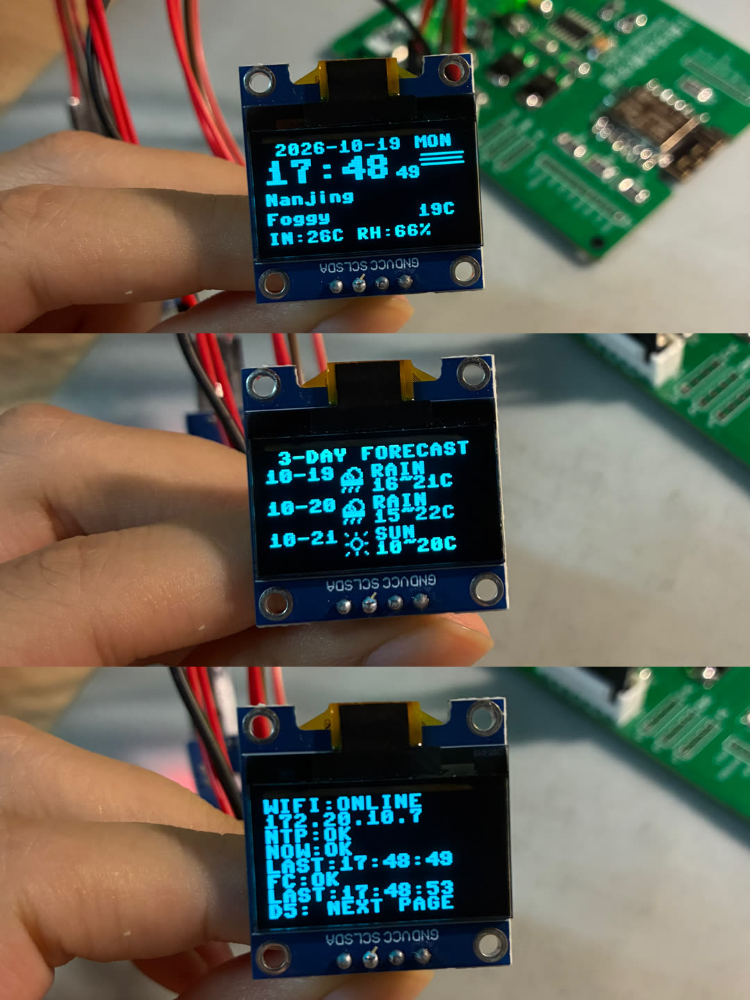
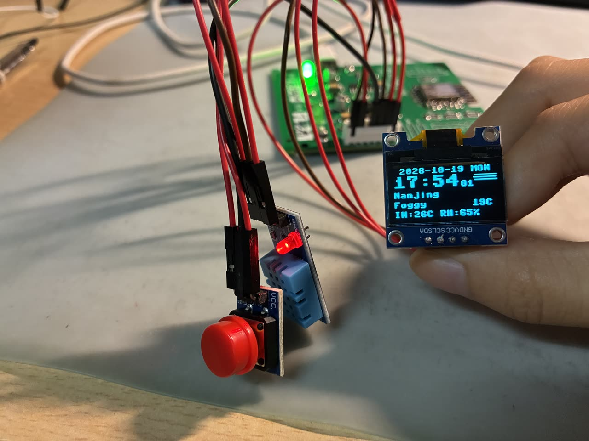

# ESP8266 MicroPython 天气时钟

基于 ESP8266、MicroPython 和 uPyCraft 的天气时钟。设备通过 Wi-Fi 获取心知天气当前数据和三日预报，通过 NTP 同步北京时间，并在 SSD1306 OLED 上显示天气图标、时间及 DHT11 室内温湿度。





[观看实物演示视频](assets/demo.mp4)

## 主要功能

1. 时间显示：显示时、分、秒、年、月、日和星期；通过 NTP 自动同步北京时间。
2. 当前天气：显示城市、天气文字、当前温度和天气图标，并显示 DHT11 测得的室内温湿度。
3. 三日预报：显示今天、明天、后天的日期、白天天气图标、天气类别以及最低/最高温度。
4. 页面切换：按下 D5 按键，循环切换当前天气页、三日预报页和网络状态页。
5. 异常处理：显示 Wi-Fi、NTP、当前天气和预报状态；更新失败时保留上次有效数据，网络恢复后自动重试。
6. 配网方式：既可在 `config.py` 中填写 Wi-Fi，也支持 `WeatherClock` AP 网页配网。

## 硬件与接线

- ESP8266 NodeMCU 开发板
- 0.96 英寸 SSD1306 128x64 I2C OLED
- DHT11 三针温湿度模块
- 三针按键模块（实测松开为 0，按下为 1）
- 杜邦线和 USB 数据线

| 模块引脚 | ESP8266 接口 | MicroPython GPIO |
| --- | --- | --- |
| OLED SCL | D1 | GPIO5 |
| OLED SDA | D2 | GPIO4 |
| 按键 OUT / S | D5 | GPIO14 |
| DHT11 DATA / OUT | D6 | GPIO12 |
| 各模块 VCC | 3V3 | - |
| 各模块 GND | GND | - |

## 实现架构

```text
Wi-Fi / AP 配网 ---------+
NTP 北京时间 ------------+
心知天气当前数据和预报 ---+--> ESP8266 主循环 --> SSD1306 OLED 三页显示
DHT11 室内温湿度 --------+
D5 按键 -----------------+
```

`main.py` 负责主循环、定时更新和页面状态；`netconfig.py` 负责 Wi-Fi 与 AP 配网；`clock_sync.py` 负责 NTP；`http_client.py` 和 `weather.py` 请求并解析心知天气；`display.py` 绘制页面和天气图标；`ssd1306.py` 驱动 OLED。

## 运行流程

```text
[上电运行 main.py]
        |
        v
[初始化 OLED、按键、DHT11]
        |
        v
<Wi-Fi 已连接?> -- 否 --> [显示离线状态并重连 / 开启 AP 配网]
        |                              |
       是                              +----> 返回检查 Wi-Fi
        |
        v
[NTP 校时] --> [获取当前天气和三日预报]
                         |
                         v
                  <更新成功?>
                   /       \
                 是         否
                 |           |
          [保存新数据]  [保留旧数据并标记失败或过期]
                   \       /
                    v     v
             [刷新 OLED，读取按键与 DHT11]
                         |
                         +----> 返回检查 Wi-Fi
```

## 使用 uPyCraft 上传

本项目已在 ESP8266 MicroPython 1.20 实机验证。由于 ESP8266 内存有限，设备运行请使用 `device_upload` 中的 `.mpy` 文件，不要把 `src` 中所有可读源码直接上传到设备。

1. 复制 `device_upload/config.example.py`，将副本命名为 `config.py`。
2. 在 `config.py` 中填写 2.4 GHz Wi-Fi 名称、密码、心知天气私钥和城市。不要把包含真实密码或私钥的 `config.py` 提交到 GitHub。
3. 在 uPyCraft 中选择 `Tools -> Board -> esp8266`，再选择开发板对应串口。
4. 将 `device_upload` 中 6 个 `.mpy` 文件、`config.py`、`main.py` 和 `demo.py` 全部上传到设备根目录。先上传辅助文件，最后上传 `main.py`。
5. 按开发板 RST，设备会自动运行 `main.py`。

如果不在配置文件中填写 Wi-Fi，设备会开启名为 `WeatherClock` 的热点，密码为 `weather8266`。手机连接后访问 OLED 提示的地址（通常为 `http://192.168.4.1`）即可配置网络。

## 课堂演示

设备文件已经上传完成时，只需打开手机 2.4 GHz 热点，用 USB 连接开发板，然后：

1. 打开 uPyCraft，选择 ESP8266 和正确串口。
2. 打开仓库根目录的 `demo.py`。
3. 按 `Ctrl+C` 停止旧程序，看到 `>>>` 后点击 Run / DownloadAndRun。
4. OLED 显示后，按 D5 外接按键依次展示三个页面。

第三页状态中，`NOW` 代表当前天气，`FC` 代表三日预报，`LAST` 是最后一次成功更新时间。`FAIL` 表示从未成功获取；`STALE` 表示更新失败但正在显示上次有效数据；`OFFLINE` 表示 Wi-Fi 已断开。

## 目录说明

```text
.
|-- demo.py               # uPyCraft 课堂演示入口
|-- src/                  # 可阅读、可修改的 MicroPython 源码
|-- device_upload/        # ESP8266 MicroPython 1.20 上传文件
|-- assets/               # 两张实物图片和一个演示视频
|-- LICENSE
`-- README.md
```

## 参考

天气接口与字段参考 [jeason-j/ESP8266-Seniverse](https://github.com/jeason-j/ESP8266-Seniverse)。本项目使用 MicroPython 重新实现网络请求、数据解析与 OLED 界面，不依赖其 Arduino C++ 库。
